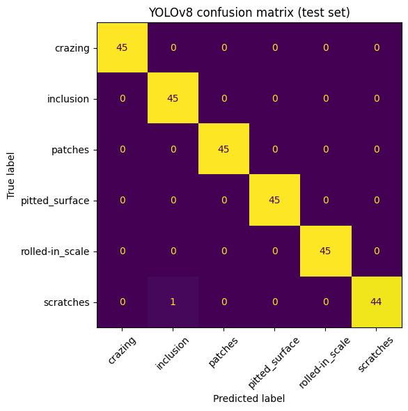

# Industrial Product Defect Detection & Inspection System

Image-level classification of six steel surface defect types (not bounding-box detection), comparing a classical OpenCV + Random Forest baseline with a YOLOv8 classifier.

## Goal
Build and fairly evaluate an automated visual inspection pipeline: given a grayscale image of a steel surface, predict which defect it shows. This is a small-scale version of the inspection tasks used in industrial image processing.

## Dataset
NEU Surface Defect Database (Northeastern University): 1,799 grayscale images (200x200 px) after removing one exact duplicate, six classes: crazing, inclusion, patches, pitted surface, rolled-in scale, scratches.
Source: https://www.kaggle.com/datasets/kaustubhdikshit/neu-surface-defect-database
The data is not included in this repository.

## Method
1. **Split:** stratified 70 / 15 / 15 into train (1,259), validation (270) and test (270) images. The test set is only used for the final evaluation.
2. **Baseline:** OpenCV features (Gaussian blur, Sobel gradients, Canny edges, Laplacian variance, Otsu threshold and contours, 16-bin brightness histogram) classified with a Random Forest (300 trees).
3. **Deep learning:** YOLOv8n-cls (pretrained, transfer learning), 20 epochs, image size 224, batch 32.
4. **Evaluation:** accuracy, macro F1, confusion matrix, per-class recall, inference time, error analysis.

## Results (test set, 270 images)

| Method | Accuracy | Macro F1 |
|---|---|---|
| OpenCV features + Random Forest | 97.8% | 0.98 |
| YOLOv8n-cls | 99.6% | 1.00 |

YOLOv8 made 1 error in 270 images: one scratch classified as inclusion. Inference time was 2.7 ms per image on a Colab GPU (measured on the test set with batch prediction).

## Limitations
- NEU is a clean, controlled dataset (same lighting and image size). Even the simple baseline reaches 97.8%, so real factory data with changing lighting, rare defects and subtle flaws would be harder.
- It is a classification task, so it does not locate defects in the image.
- The data is steel, not pharmaceutical products; the method is general, but the results are not transferable without new data.

## How to run
Open `NEU_Defect_Inspection.ipynb` in Google Colab, choose a GPU runtime, and run all cells.
Libraries: see `requirements.txt`.
